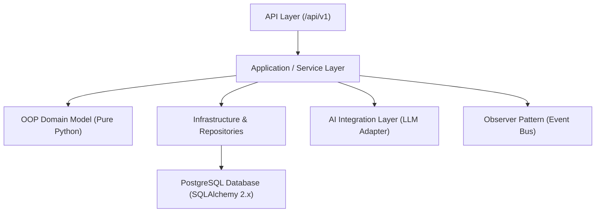

# I-ITSM — Intelligent IT Service Management & Incident Resolution System

[](https://www.python.org/downloads/)
[](https://fastapi.tiangolo.com)
[](https://www.sqlalchemy.org/)
[]()
[](https://github.com/astral-sh/ruff)

An enterprise-grade, object-oriented incident management and resolution system developed for **CS F213 / MAC F212 (Object-Oriented Programming)**. This repository houses the unified backend foundation featuring an extensible layered architecture, a fully functioning technician assignment engine (Member 3), interchangeable assignment algorithms, and provider-independent AI recommendations.

---

## 1. Project Objectives

Modern enterprise organizations manage thousands of digital incidents daily across cloud services, networks, authentication clusters, and databases. I-ITSM replaces fragile, manual ticket handling with:

- **Strict OOP Domain Modeling:** Encapsulation of domain invariants, abstraction of algorithms, and polymorphism across strategies.
- **Intelligent Technician Allocation:** Two deterministic assignment algorithms (`SkillBasedAssignmentStrategy` and `LeastLoadedAssignmentStrategy`) combined with an LLM-assisted recommendation engine.
- **Full Incident Lifecycle Enforcement:** State-machine transitions (`NEW` $\rightarrow$ `CLASSIFIED` $\rightarrow$ `ASSIGNED` $\rightarrow$ `ACKNOWLEDGED` $\rightarrow$ `IN_PROGRESS` $\rightarrow$ `RESOLVED` $\rightarrow$ `VERIFIED` $\rightarrow$ `CLOSED`).
- **Clean Cross-Module Integration:** Four-member ownership boundaries coordinated through explicit application interfaces and domain events without data coupling.

---

## 2. Technology Stack

- **Backend Framework:** [FastAPI](https://fastapi.tiangolo.com) (Python 3.12+)
- **Server:** [Uvicorn](https://www.uvicorn.org/)
- **Data Validation & DTOs:** [Pydantic v2](https://docs.pydantic.dev/)
- **ORM & Persistence:** [SQLAlchemy 2.x (Asyncio)](https://docs.sqlalchemy.org/en/20/)
- **Database Driver:** [Psycopg 3](https://www.psycopg.org/psycopg3/) / [aiosqlite](https://aiosqlite.omnilib.dev/) (for tests)
- **Database:** PostgreSQL 16
- **Database Migrations:** [Alembic](https://alembic.sqlalchemy.org/)
- **Test Harness:** [pytest](https://docs.pytest.org/) & `pytest-asyncio`
- **Linter & Formatter:** [Ruff](https://astral.sh/ruff)
- **AI Integration:** Async HTTPX adapter with OpenAI-compatible completion APIs + deterministic Mock provider.

---

## 3. Architecture Overview

I-ITSM is built as a **Layered Modular Monolith**:



### Module Boundaries & Team Ownership

- **Member 1 (Platform & Access):** Identity, authentication, users, roles, IT service catalog, categories.
- **Member 2 (Incident Lifecycle):** Incident CRUD, priority scoring, lifecycle transitions, comments, duplicate detection.
- **Member 3 (Technician & Assignment - Implemented Here):** Technician profiles, skills catalog, availability state, workload tracking, assignment strategies, LLM-enhanced recommendations.
- **Member 4 (SLA & Automation):** SLA policy timers, deadline monitoring, audit log timeline, email/in-app notifications.

---

## 4. Repository Structure

```
I-ITSM/
├── backend/
│   ├── app/
│   │   ├── api/                # API Presentation Layer
│   │   │   ├── deps.py         # FastAPI dependency injection
│   │   │   └── v1/
│   │   │       ├── router.py   # Aggregated v1 router
│   │   │       ├── schemas.py  # Pydantic v2 camelCase DTOs
│   │   │       ├── technicians.py
│   │   │       └── assignment.py
│   │   ├── application/        # Application Use Cases
│   │   │   ├── assignment/     # Recommendation & assignment services
│   │   │   ├── technician/     # Profile & skill management services
│   │   │   └── interfaces/     # Abstract boundaries (Repositories, Services, Events)
│   │   ├── core/               # Configuration, security, exceptions, logging
│   │   ├── domain/             # Pure OOP Domain (No framework dependencies)
│   │   │   ├── assignment/     # Strategies, context, recommendation entities
│   │   │   ├── identity/       # User identity value object
│   │   │   ├── incident/       # Incident reference projection
│   │   │   └── technician/     # Technician & skill aggregate roots
│   │   ├── infrastructure/     # Database, repositories, event bus
│   │   │   ├── database/       # SQLAlchemy models, async session engine
│   │   │   ├── events/         # InProcessEventBus (Observer Pattern)
│   │   │   └── repositories/   # SQLAlchemyTechnicianRepository
│   │   ├── integrations/       # Cross-module adapters & external LLM
│   │   │   ├── incidents/      # Member 2 integration boundary & test stub
│   │   │   └── llm/            # LLM adapter, prompts, mock provider, factory
│   │   └── shared/             # Team-wide enums and types
│   ├── migrations/             # Alembic migration revisions
│   ├── tests/                  # 38 unit, integration, and API tests
│   ├── alembic.ini             # Migration config
│   ├── pyproject.toml          # Build and dependencies
│   ├── Dockerfile              # Production container build
│   └── .env.example            # Environment template
├── frontend/                   # React frontend integration placeholder
├── docs/                       # Architecture & design documentation
│   ├── ARCHITECTURE.md
│   ├── API_CONTRACTS.md
│   ├── DATABASE_DESIGN.md
│   ├── ASSIGNMENT_ALGORITHM.md
│   ├── LLM_INTEGRATION.md
│   ├── OOP_DESIGN.md
│   ├── INTEGRATION_GUIDE.md
│   └── TEAM_HANDOFF.md
├── docker-compose.yml          # Multi-container local orchestration
├── PROJECT_CONTRACT.md         # Binding team agreement & proposed changes
└── README.md
```

---

## 5. Prerequisites

- **macOS / Linux / Windows WSL2**
- **Python 3.12+** (tested on Python 3.12 and Python 3.14)
- **PostgreSQL 16+** (or Docker)
- **Git**

---

## 6. Quick Start & Setup

### 6.1 Clone & Setup Environment

```bash
git clone <repo-url>
cd I-ITSM/backend

# Create virtual environment
python3 -m venv .venv
source .venv/bin/activate

# Install dependencies and dev tools
pip install --upgrade pip
pip install -e ".[dev]"
```

### 6.2 Configure Environment

```bash
cp .env.example .env
# Edit .env if using a custom PostgreSQL instance or LLM provider
```

### 6.3 Run with Docker Compose (Recommended)

From the project root:

```bash
docker compose up -d db
```

### 6.4 Apply Database Migrations

```bash
cd backend
alembic upgrade head
```

### 6.5 Start Backend Server

```bash
cd backend
uvicorn app.main:create_app --factory --reload --port 8000
```

- Interactive API Documentation (Swagger): [http://localhost:8000/docs](http://localhost:8000/docs)
- Alternative API Documentation (ReDoc): [http://localhost:8000/redoc](http://localhost:8000/redoc)
- Health Check: [http://localhost:8000/health](http://localhost:8000/health)

---

## 7. Running Tests & Quality Checks

The automated test suite runs completely offline with zero external network or database dependencies using in-memory SQLite and a deterministic mock LLM adapter.

```bash
cd backend

# Run all 38 test cases
pytest -v

# Run with coverage report
pytest --cov=app tests/

# Run Ruff linter and formatter
ruff check .
ruff format --check .
```

---

## 8. LLM Configuration & Fallback

The LLM integration is provider-independent via the **Adapter Pattern**:

```bash
# In backend/.env:
LLM_PROVIDER=mock              # Options: mock, openai_compatible
LLM_API_KEY=your-api-key       # Required for openai_compatible
LLM_MODEL=gpt-4o-mini          # Model identifier
LLM_TIMEOUT_SECONDS=15
LLM_MAX_RETRIES=2
```

### Resilience Guarantee

If the LLM endpoint is unreachable, times out, or returns invalid JSON, the system automatically and transparently falls back to deterministic recommendations (`SkillBasedAssignmentStrategy` or `LeastLoadedAssignmentStrategy`), attaching a fallback diagnostic note without throwing a 500 error.

---

## 9. Git Workflow for Team Members

1. Never commit directly to `main`.
2. All feature branches must branch off `develop`:
   - `feature/member-1-platform`
   - `feature/member-2-incidents`
   - `feature/member-3-technicians`
   - `feature/member-4-sla`
3. Before submitting a PR into `develop`:
   - Ensure `pytest` passes 100%.
   - Ensure `ruff check .` has 0 errors.
   - Update `PROJECT_CONTRACT.md` if any schema or API contract changed.

---

## 10. Member 1 Platform & Frontend

The platform module provides:

- Employee registration and login using bcrypt password hashing and JWT authentication.
- Role-based access for Employees, Technicians and Administrators.
- Administrator user management, including role updates and account deactivation.
- IT service catalogue with business criticality levels from 1 to 5.
- Incident category configuration and required technician skill mapping.
- Administrative summary reporting for users, services and categories.

### React Frontend

The React application is located in `frontend/` and uses Vite.

Start the frontend:

```powershell
cd frontend
npm install
npm run dev -- --port 3000
```

Open `http://localhost:3000`.

### Local SQLite Demonstration

For local development without PostgreSQL or Docker, the backend can use SQLite:

```powershell
cd backend
.\.venv\Scripts\Activate.ps1
$env:DATABASE_URL = "sqlite+aiosqlite:///./iitsm.db"
alembic upgrade head
uvicorn app.main:app --reload --port 8000
```

The SQLite database file is stored locally as `backend/iitsm.db`.

The normal team environment remains PostgreSQL as specified in the project configuration. SQLite is used here as a convenient local demonstration and test database.
