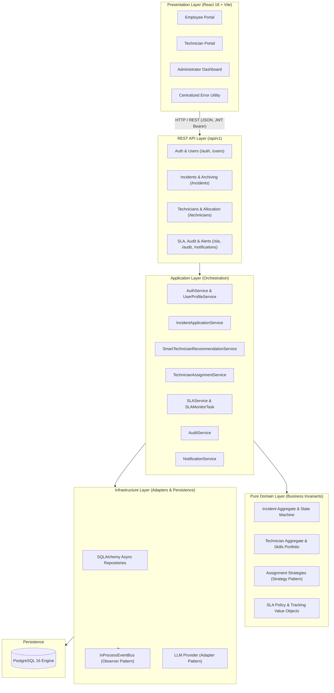
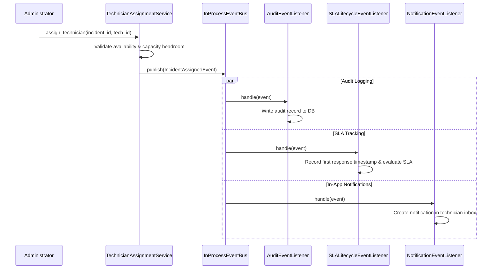

# I-ITSM — System Architecture Specification

## 1. Architectural Philosophy & Overview

**I-ITSM** is designed as a **Layered Modular Monolith** adhering to Domain-Driven Design (DDD) principles, Clean Architecture, and the Information Technology Infrastructure Library (ITIL) v4 incident management lifecycle.

---

## 2. Layered Architecture Breakdown

### 2.1 Presentation Layer (Frontend & REST API)
- **Frontend SPA (React 18 + Vite):** Role-tailored dashboards for Employees, Technicians, and Administrators. Communicates via native `fetch` with centralized JWT injection, error extraction, and toast notifications.
- **FastAPI Endpoints (`app/api/v1/`):** 41 asynchronous endpoints enforcing schema validation via Pydantic v2 `BaseDTO` models with automatic `camelCase` $\leftrightarrow$ `snake_case` aliasing.

### 2.2 Application Layer (`app/application/`)
- Orchestrates domain entities and infrastructure repositories to satisfy use cases.
- Implements two-phase assignment safety, duplicate merging logic, manual SLA check sweeps, and scheduled background monitoring tasks.

### 2.3 Pure Domain Layer (`app/domain/`)
- Zero dependencies on frameworks, databases, or HTTP libraries.
- Encapsulates domain rules and invariants:
  - Skill proficiency bounds ($1$–$5$).
  - Workload capacity limits ($\text{activeCount} < \text{maxCapacity}$).
  - Forward-only incident lifecycle state machine.
  - Mathematical priority scoring formulas.

### 2.4 Infrastructure Layer (`app/infrastructure/`)
- Implements repository interfaces using SQLAlchemy 2.0 Asyncio with Psycopg 3.
- Event-driven publish-subscribe bus (`InProcessEventBus`) decoupling event producers from consumers.
- AI provider adapters (`MockLLMProvider`, `OpenAICompatibleProvider`).

---

## 3. Four-Module Domain Partitioning

| Module | Primary Responsibility | Tables Owned | Key Invariants Enforced |
|---|---|---|---|
| **M1: Identity & Platform** | User authentication, RBAC, service catalogue, incident categories, KPI summary | `users`, `services`, `incident_categories` | Salted bcrypt passwords, signed JWTs, unique emails/usernames |
| **M2: Incident Lifecycle** | Incident creation, priority scoring, lifecycle state transitions, comments, duplicate merging, soft-archiving | `incidents`, `incident_comments` | Deterministic priority matrix, strict forward state progression, mandatory resolution text |
| **M3: Technician Management** | Operational profiles, skills portfolio, workload capacity, deterministic & AI candidate ranking | `technicians`, `technician_skills` | Skill rating $1$–$5$, capacity headroom, availability filtering |
| **M4: SLA & Automation** | Target response/resolution deadlines, periodic background monitor, unread notifications, audit logs | `sla_policies`, `incident_sla_tracking`, `audit_logs`, `notifications` | 60-second polling daemon, 80% warning threshold, immutable audit history |

---

## 4. Asynchronous Event-Driven Architecture (Observer Pattern)

I-ITSM uses an in-process event bus (`InProcessEventBus`) to decouple domain actions from downstream effects:

---

## 5. Security & Authentication Architecture

- **Token Standard:** JSON Web Tokens (JWT) signed with symmetric `HS256` encryption via `python-jose`.
- **Payload Claims:** Canonical user identifier `sub` (UUID v4), `role` (`EMPLOYEE`, `TECHNICIAN`, `ADMIN`), and expiration timestamp `exp`.
- **RBAC Enforcement:** FastAPI dependency injection (`require_role`, `get_current_user_id`) validates permissions at the route handler level before service execution.
- **Zero-UUID UI Paradigm:** Internal UUIDs are strictly decoupled from user-facing presentations. The frontend displays user-friendly incident codes (`INC-xxxxxxxx`), technician names, and skill badges.
