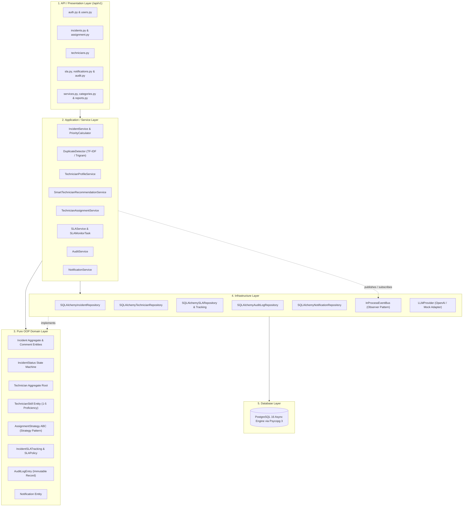
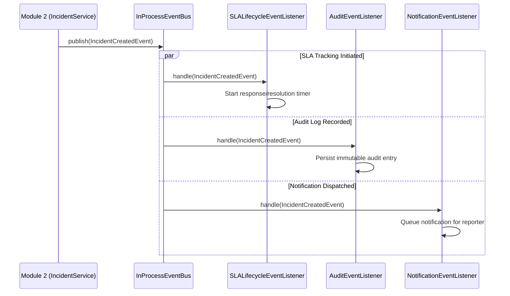

# System Architecture Specification

## 1. Architectural Style: Layered Modular Monolith

I-ITSM is structured as a **Layered Modular Monolith**. All enterprise modules reside within a single high-performance FastAPI backend application, maintaining strict package boundaries, clean domain encapsulation, and unidirectional dependency flows.

---

## 2. Dependency Direction & Layering Rules

1. **Domain Layer (`app/domain/`):** Pure Python domain models, aggregates, state transitions, and business invariants. Contains zero framework imports (no FastAPI, no SQLAlchemy, no Pydantic, no HTTPX).
2. **Application Layer (`app/application/`):** Coordinates use cases, encapsulates business workflows, orchestrates domain aggregates, and communicates with repositories via abstract interfaces (`app/application/interfaces/`).
3. **Infrastructure Layer (`app/infrastructure/`):** Implements physical persistence via SQLAlchemy 2.x async models, manages transactions, and hosts the in-process event bus and external LLM adapters.
4. **Presentation Layer (`app/api/`):** Handles HTTP request parsing, Pydantic v2 validation, security authentication, and serialises response DTOs. Contains zero business rules.

---

## 3. Four Integrated Functional Modules

### Module 1: Identity, Platform & Administration
- **Ownership:** User registry, authentication, role verification (`EMPLOYEE`, `TECHNICIAN`, `ADMIN`), IT service catalogue, category-to-skill mappings, and executive reporting.
- **Key Services:** FastAPI auth dependencies (`get_current_user_id`, `require_role`), bcrypt password hashing, JWT token issuance.
- **Database Models:** `UserModel`, `ServiceModel`, `CategoryModel`.

### Module 2: Incident Management & Lifecycle
- **Ownership:** Incident reporting, priority calculation matrix ($P1$ to $P4$), state machine transitions, comment streams, duplicate detection, soft-archiving, and duplicate merging.
- **Key Services:** `IncidentService`, `PriorityCalculator`, `DuplicateDetector`.
- **Database Models:** `IncidentModel`, `IncidentCommentModel`.

### Module 3: Technician & Assignment Engine
- **Ownership:** Operational technician profiles, skill catalogs with proficiency ratings (1–5), capacity headroom verification, deterministic ranking algorithms, and AI-assisted recommendations.
- **Key Services:** `TechnicianProfileService`, `SmartTechnicianRecommendationService`, `TechnicianAssignmentService`, `AssignmentStrategyFactory`.
- **Database Models:** `TechnicianModel`, `TechnicianSkillModel`.

### Module 4: SLA, Notifications & Audit Trail
- **Ownership:** Target response and resolution SLA policy monitoring per priority level, scheduled background breach evaluation (`SLAMonitorTask`), in-app user notifications, and immutable audit logs.
- **Key Services:** `SLAService`, `SLAMonitorTask`, `NotificationService`, `AuditService`.
- **Database Models:** `SLAPolicyModel`, `IncidentSLATrackingModel`, `NotificationModel`, `AuditLogModel`.

---

## 4. Event-Driven Cross-Module Communication (Observer Pattern)

To maintain loose coupling across module boundaries, cross-module side-effects are decoupled using the **InProcessEventBus**:

### Supported Domain Events:
- `IncidentCreatedEvent` $\rightarrow$ Triggers SLA timer start, audit trail record, and employee creation notification.
- `IncidentAssignedEvent` $\rightarrow$ Triggers SLA response mark, audit trail record, and technician assignment notification.
- `IncidentStatusChangedEvent` $\rightarrow$ Triggers SLA resolution verification, audit trail record, and status change alerts.
- `SLAWarningEvent` $\rightarrow$ Dispatches approaching-breach alerts to assigned technicians and administrators.
- `SLABreachedEvent` $\rightarrow$ Records official SLA breach flag and notifies stakeholders.

---

## 5. Dependency Injection Architecture

FastAPI's dependency injection (`Depends`) enforces the **Dependency Inversion Principle** across the entire application:
- Endpoints declare dependencies on abstract interfaces (`TechnicianRepository`, `IncidentRepository`, `SLATrackingRepository`, `AuditLogRepository`, `NotificationRepository`, `LLMProvider`, `EventPublisher`).
- `app/api/deps.py` resolves dependencies to concrete SQLAlchemy implementations within the per-request transaction scope.
- In automated testing, `app.dependency_overrides` substitutes test doubles (such as in-memory SQLite and mock LLM adapters) without modifying any application source code.
