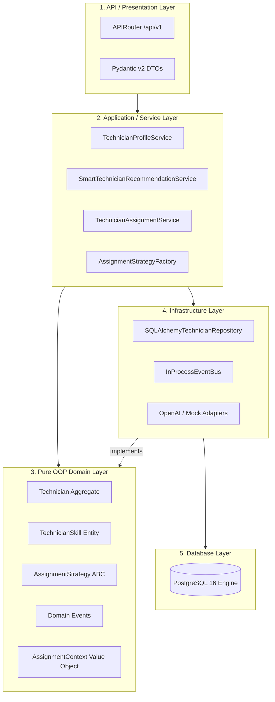

# System Architecture Specification

## 1. Architectural Style: Layered Modular Monolith

I-ITSM is structured as a **Layered Modular Monolith**. All team modules reside within a single backend application, maintaining strict internal package boundaries and unidirectional dependency flows.



### Dependency Direction Rules
1. **Domain Layer:** Pure Python (`dataclasses`, `abc`). It contains zero imports from FastAPI, SQLAlchemy, HTTPX, or any external vendor library.
2. **Application Layer:** Orchestrates domain entities and interfaces. Depends only on domain models and abstract application interfaces.
3. **Infrastructure Layer:** Implements persistence, external HTTP calls, and event dispatching. Implements abstract interfaces declared in the application/domain layers.
4. **API Layer:** Validates HTTP request bodies, calls application services, and returns formatted JSON DTOs. Contains zero domain business logic.

---

## 2. Module Boundaries

```
app/
├── api/v1/             # Endpoints for all modules
├── application/        # Application services partitioned by domain concern
├── domain/             # Entities, aggregates, and value objects
├── infrastructure/     # Database models, ORM repositories, and event bus
├── integrations/       # Out-of-process adapters (LLM, Member stubs)
└── shared/             # Enums, common types, base models
```

### Member Module Responsibilities
- **Member 1 (Identity & Admin):** Authentication tokens, user registry, service catalog criticality ratings.
- **Member 2 (Incident Management):** Incident creation, status state machine, priority calculation, duplicate detection.
- **Member 3 (Technician & Assignment):** Technician profiles, skill levels, workload management, interchangeable assignment strategies, LLM recommendations.
- **Member 4 (SLA & Notifications):** SLA policies, response/resolution tracking, audit timeline, multi-channel notifications.

---

## 3. Dependency Injection Architecture

FastAPI's dependency injection (`Depends`) is utilized to enforce the **Dependency Inversion Principle**:
- Endpoints request abstract interfaces (`TechnicianRepository`, `IncidentServiceBoundary`, `LLMProvider`, `EventPublisher`).
- `app/api/deps.py` resolves dependencies to concrete implementations at runtime.
- In automated tests, `app.dependency_overrides` substitutes test doubles without modifying production application code.
