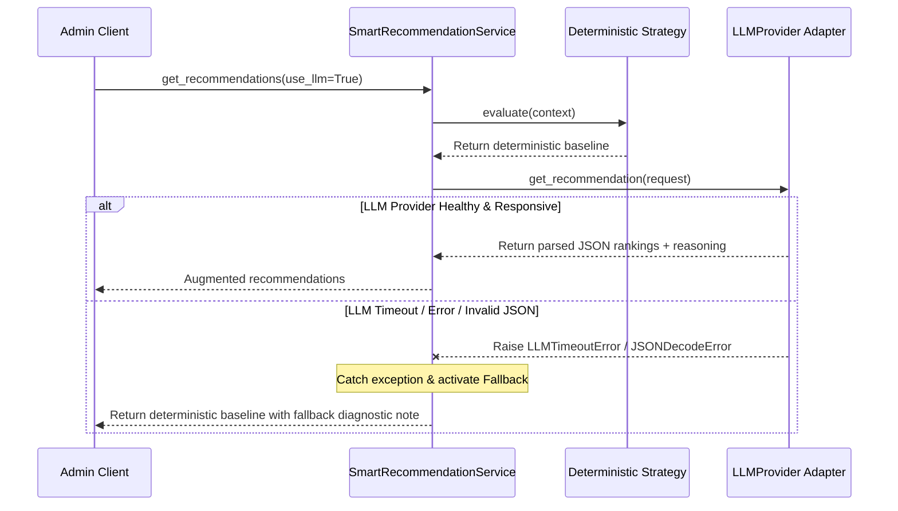

# I-ITSM — Technician Assignment Algorithms & AI Recommendations

The I-ITSM Assignment Engine implements the **Strategy Pattern** via the abstract base class `AssignmentStrategy`. Two concrete strategies are provided out of the box, with support for optional AI-assisted ranking and guaranteed deterministic fallback.

---

## 1. Hard Eligibility Filters (Pre-Ranking Stage)

Before any algorithmic ranking or scoring occurs, all technicians in the enterprise pool must satisfy three non-negotiable hard eligibility criteria:

1. **Operational Availability:**
   $$\text{status} = \text{AVAILABLE}$$
   Technicians in `BUSY`, `OFFLINE`, or `ON_LEAVE` status are strictly excluded from assignment recommendations.

2. **Skill Competency Match:**
   $$\text{requiredSkill} \in \{\text{technicianSkills}\}$$
   The technician must possess a verified proficiency rating in the incident's required technical domain (case-insensitive string comparison).

3. **Active Capacity Headroom:**
   $$\text{activeIncidentCount} < \text{maxCapacity}$$
   The technician's current open workload must have at least one slot of remaining capacity.

If zero technicians satisfy all three criteria, the engine raises `NoEligibleTechnicianError`.

---

## 2. Strategy A: Skill-Based Ranking (`SkillBasedAssignmentStrategy`)

### 2.1 Formula & Weighting
Calculates a composite suitability score:

$$\text{Score} = (\text{Proficiency Level} \times 20) + (\text{Experience Years} \times 2)$$

- **Proficiency Level ($1$ to $5$):** Scaled by $20\times$ to yield a baseline between $20$ and $100$ points, ensuring technical mastery remains the primary ranking determinant.
- **Experience ($0$ to $30+$ years):** Scaled by $2\times$ to act as a secondary differentiator between candidates with identical skill proficiency.

### 2.2 Ranking & Deterministic Tie-Breaking
1. Candidates are sorted **descending** by $\text{Score}$.
2. Any remaining ties are broken deterministically by sorting technician `user_id` string representations alphabetically.
3. Generates transparent justification text describing the score components.

---

## 3. Strategy B: Least-Loaded Ranking (`LeastLoadedAssignmentStrategy`)

### 3.1 Objective & Balancing
Evenly distributes operational workload across the technical engineering staff by routing incidents to candidates with the lowest active ticket counts.

### 3.2 Compound Sort Key
1. **Primary Sort:** `active_incident_count` **ascending** (lowest open tickets first).
2. **First Tie-Break:** `experience_years` **descending** (if workloads are equal, prioritize the more experienced engineer).
3. **Second Tie-Break:** `user_id` string representation **ascending** (guarantees deterministic, reproducible ranking).

---

## 4. AI-Assisted Recommendation Engine (`SmartTechnicianRecommendationService`)

The recommendation engine implements the **Adapter Pattern** via `LLMProvider` (`MockLLMProvider`, `OpenAICompatibleProvider`), augmenting deterministic scores with AI reasoning.



### 4.1 Strict Privacy & Zero-PII Guarantee
To safeguard enterprise data confidentiality:
- **Transmitted Data:** Anonymized technician UUID strings, technical skill names, numeric proficiency ratings ($1$–$5$), years of experience, current active incident counts, capacity limits, incident category, priority level, and technical description.
- **Protected Data (Never Transmitted):** Full names, email addresses, phone numbers, employee IDs, reporter identities, user passwords, or internal network IP addresses.

### 4.2 Guaranteed Deterministic Fallback
Under no circumstances will an external LLM outage cause an API failure (`500 Internal Server Error`). If the LLM provider fails, times out, or returns invalid syntax, the service catches the exception and immediately falls back to the deterministic rankings.

### 4.3 Switching from Mock to a Real LLM Model

By default, I-ITSM runs in offline mode using `LLM_PROVIDER=mock`. To connect a live model, update `backend/.env` without changing any code:

#### A. OpenAI (GPT-4o-mini / GPT-4o)
```env
LLM_PROVIDER=openai_compatible
LLM_API_KEY=sk-proj-your-openai-api-key
LLM_MODEL=gpt-4o-mini
LLM_BASE_URL=https://api.openai.com/v1
LLM_ENABLED=true
LLM_TIMEOUT_SECONDS=30
LLM_MAX_RETRIES=2
```

#### B. Free Local LLM via Ollama (No API Key Required)
```env
LLM_PROVIDER=openai_compatible
LLM_API_KEY=ollama
LLM_MODEL=llama3.2
LLM_BASE_URL=http://localhost:11434/v1
LLM_ENABLED=true
LLM_TIMEOUT_SECONDS=60
LLM_MAX_RETRIES=1
```

#### C. Groq (Fast Inference Cloud)
```env
LLM_PROVIDER=openai_compatible
LLM_API_KEY=gsk_your-groq-api-key
LLM_MODEL=llama-3.3-70b-versatile
LLM_BASE_URL=https://api.groq.com/openai/v1
LLM_ENABLED=true
LLM_TIMEOUT_SECONDS=15
LLM_MAX_RETRIES=2
```

#### D. Google Gemini (via OpenAI-Compatible Endpoint)
```env
LLM_PROVIDER=openai_compatible
LLM_API_KEY=your-gemini-api-key
LLM_MODEL=gemini-1.5-flash
LLM_BASE_URL=https://generativelanguage.googleapis.com/v1beta/openai/
LLM_ENABLED=true
LLM_TIMEOUT_SECONDS=20
LLM_MAX_RETRIES=2
```