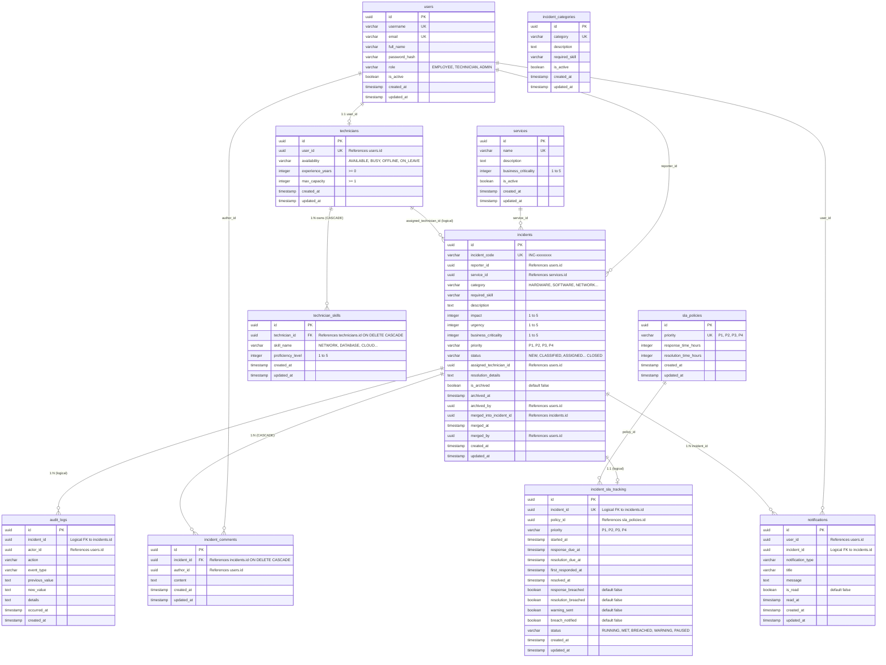

# Database Design & Schema Specification

## 1. Relational Entity-Relationship Diagram



---

## 2. Table Catalog & Ownership Matrix

| Table Name | Owning Module | Foreign Key References | Purpose |
|---|---|---|---|
| `users` | M1 (Identity) | None | System user accounts, credentials, and roles (`EMPLOYEE`, `TECHNICIAN`, `ADMIN`). |
| `services` | M1 (Platform) | None | IT service catalogue entries with business criticality ratings (1–5). |
| `incident_categories` | M1 (Platform) | None | Allowed incident classification categories and skill mappings. |
| `technicians` | M3 (Technicians) | `user_id` $\rightarrow$ `users.id` (Unique) | Operational technician profiles, availability, capacity, and experience. |
| `technician_skills` | M3 (Technicians) | `technician_id` $\rightarrow$ `technicians.id` (Cascade) | Technical competencies and skill proficiency levels (1–5). |
| `incidents` | M2 (Incidents) | `reporter_id`, `service_id`, `assigned_technician_id` | Core incident tickets, priority, state machine status, archiving, and merging. |
| `incident_comments` | M2 (Incidents) | `incident_id` $\rightarrow$ `incidents.id` (Cascade) | Collaboration notes and resolution discussion thread. |
| `sla_policies` | M4 (SLA) | None | Standard response and resolution time targets for priority levels $P1$–$P4$. |
| `incident_sla_tracking` | M4 (SLA) | `incident_id`, `policy_id` | Live tracking records of active response/resolution timers and breach flags. |
| `audit_logs` | M4 (Audit) | `incident_id`, `actor_id` | Immutable append-only audit trail capturing all lifecycle and administrative events. |
| `notifications` | M4 (Notifications)| `user_id`, `incident_id` | Recipient alert delivery inbox with read/unread flags. |

---

## 3. Indexing & Integrity Constraints

1. **Unique Constraints:**
   - `users.username` & `users.email`: Enforces login and email uniqueness.
   - `services.name`: Prevents duplicate service catalogue entries.
   - `incident_categories.category`: Prevents duplicate category definitions.
   - `technicians.user_id`: Enforces a strict 1-to-1 relationship between an M1 User and an M3 Technician profile.
   - `technician_skills (technician_id, skill_name)`: Prevents duplicate skill records on the same technician profile.
   - `incidents.incident_code`: Enforces canonical ticket code uniqueness (`INC-xxxxxxxx`).
   - `sla_policies.priority`: Guarantees exactly one policy per priority level ($P1$, $P2$, $P3$, $P4$).
   - `incident_sla_tracking.incident_id`: Enforces single active SLA tracking record per incident.
2. **Performance Indexes:**
   - `ix_incidents_status_priority`: Composite index optimizing queue filtering by status and urgency.
   - `ix_incidents_reporter_created`: Optimizes Employee "My Incidents" timeline queries.
   - `ix_incidents_assigned_status`: Optimizes Technician assigned workload queries.
   - `ix_incidents_is_archived`: Accelerates active vs. archived incident separation.
   - `ix_incidents_merged_into`: Optimizes child incident lookup during duplicate tree resolution.
   - `ix_technician_skills_skill_name`: Accelerates candidate filtering during recommendation runs.
   - `ix_notifications_user_read`: Optimizes unread notification polling (`/notifications/unread/count`).
   - `ix_audit_logs_incident_occurred`: Optimizes chronological audit trail retrieval.

---

## 4. Alembic Migration History

All schema revisions are version-controlled in `backend/migrations/versions/`:

| Revision | File Name | Description |
|---|---|---|
| `001` | `001_initial_technician_schema.py` | Creates initial `technicians` and `technician_skills` tables. |
| `002` | `002_create_users.py` | Creates `users` table with username, email, password hash, and role enum. |
| `003` | `003_services_and_categories.py` | Creates `services` and `incident_categories` tables. |
| `004` | `004_incidents_and_comments.py` | Creates `incidents` and `incident_comments` tables with foreign keys and status enums. |
| `005` | `005_sla_audit_notifications.py` | Creates `sla_policies`, `incident_sla_tracking`, `audit_logs`, and `notifications` tables. |
| `006` | `006_incident_archive_merge.py` | Adds archiving (`is_archived`, `archived_at`, `archived_by`) and merging (`merged_into_incident_id`, `merged_at`, `merged_by`) columns to `incidents`. |

### Applying Migrations
```bash
cd backend
alembic upgrade head
```
