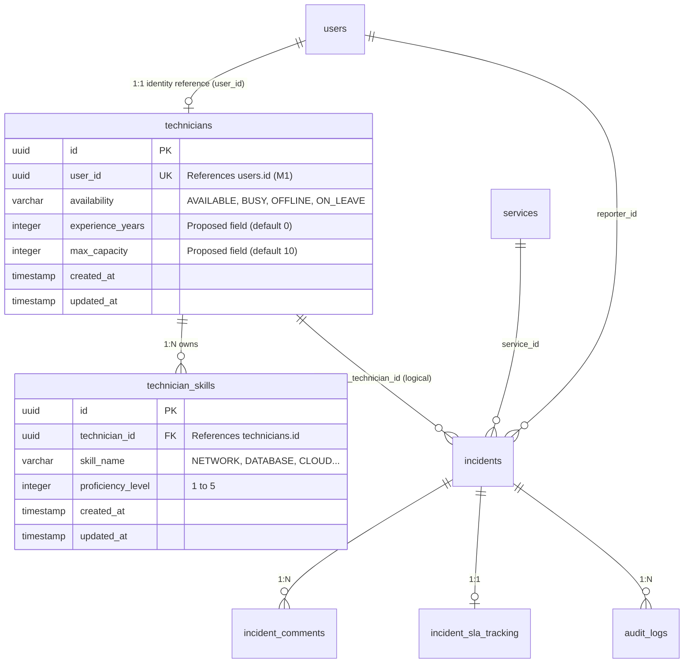

# Database Design & Schema Specification

## 1. Relational Entity-Relationship Diagram



---

## 2. Table Ownership & Boundaries

| Table Name                             | Owner             | Foreign Key Dependencies                                                                                                                           | Notes                                                  |
| -------------------------------------- | ----------------- | -------------------------------------------------------------------------------------------------------------------------------------------------- | ------------------------------------------------------ |
| `users`, `employees`, `administrators` | Member 1          | None                                                                                                                                               | Root user identity.                                    |
| `services`                             | Member 1          | None                                                                                                                                               | Service catalog & business criticality (1-5).          |
| `incident_categories`                  | Member 1          | None                                                                                                                                               | Category definition and `requiredSkill` mapping.       |
| `technicians`                          | **Member 3 (Us)** | `user_id` $\rightarrow$ `users.id`                                                                                                                 | Operational technician profile. Uses shared User UUID. |
| `technician_skills`                    | **Member 3 (Us)** | `technician_id` $\rightarrow$ `technicians.id`                                                                                                     | Technician acquired skills and ratings.                |
| `incidents`                            | Member 2          | `reporter_id` $\rightarrow$ `users.id`<br>`service_id` $\rightarrow$ `services.id`<br>`assigned_technician_id` $\rightarrow$ `technicians.user_id` | Core incident entity and lifecycle state.              |
| `incident_comments`                    | Member 2          | `incident_id` $\rightarrow$ `incidents.id`                                                                                                         | Collaboration notes.                                   |
| `sla_policies`                         | Member 4          | None                                                                                                                                               | P1-P4 duration targets.                                |
| `incident_sla_tracking`                | Member 4          | `incident_id` $\rightarrow$ `incidents.id`                                                                                                         | Deadlines & breach flags.                              |
| `audit_logs`                           | Member 4          | `incident_id` $\rightarrow$ `incidents.id`                                                                                                         | Event timeline.                                        |
| `notifications`                        | Member 4          | `user_id` $\rightarrow$ `users.id`                                                                                                                 | Recipient delivery queue.                              |

---

## 3. Indexing & Constraint Strategy

- **`ix_technicians_user_id` (Unique):** Enforces a strict 1-to-1 relationship between a Member 1 User account and a Member 3 Technician operational profile.
- **`uq_technician_skill` (Unique Constraint on `technician_id, skill_name`):** Prevents duplicate entries for the same skill on a technician.
- **`ix_technician_skills_skill_name`:** Optimizes query filtering when locating candidate technicians matching incident skill requirements.
- **`ON DELETE CASCADE`:** Deleting a technician profile automatically purges their associated skill records.

---

## 4. Migration Guidelines (Alembic)

1. Migrations are located strictly under `backend/migrations/versions/`.
2. Each member creates revision files only for tables within their ownership.
3. Merged migrations are immutable and must never be edited retroactively.
4. Run migrations locally:
   ```bash
   alembic upgrade head
   ```
5. Generate static SQL without applying:
   ```bash
   alembic upgrade head --sql
   ```

---

## 5. Member 1 Platform Tables

### 5.1 Users

The implementation uses one `users` table for all system accounts. Account types are distinguished by the `role` column rather than separate Employee, Technician and Administrator account tables.

| Column          | Type         | Constraints / Purpose         |
| --------------- | ------------ | ----------------------------- |
| `id`            | UUID         | Primary key                   |
| `username`      | VARCHAR(50)  | Unique, required              |
| `email`         | VARCHAR(255) | Unique, required              |
| `full_name`     | VARCHAR(100) | Required                      |
| `password_hash` | VARCHAR(255) | Required; bcrypt hash         |
| `role`          | VARCHAR(10)  | EMPLOYEE, TECHNICIAN or ADMIN |
| `is_active`     | BOOLEAN      | Account status                |
| `created_at`    | TIMESTAMP    | Creation timestamp            |
| `updated_at`    | TIMESTAMP    | Last update timestamp         |

### 5.2 Services

| Column                 | Type         | Constraints / Purpose |
| ---------------------- | ------------ | --------------------- |
| `id`                   | UUID         | Primary key           |
| `name`                 | VARCHAR(120) | Unique, required      |
| `description`          | TEXT         | Optional description  |
| `business_criticality` | INTEGER      | Required, range 1–5   |
| `is_active`            | BOOLEAN      | Service availability  |
| `created_at`           | TIMESTAMP    | Creation timestamp    |
| `updated_at`           | TIMESTAMP    | Last update timestamp |

The service catalogue uses soft deactivation through `is_active`.

### 5.3 Incident Categories

| Column           | Type         | Constraints / Purpose                |
| ---------------- | ------------ | ------------------------------------ |
| `id`             | UUID         | Primary key                          |
| `category`       | ENUM         | Unique shared IncidentCategory value |
| `description`    | TEXT         | Optional description                 |
| `required_skill` | VARCHAR(100) | Skill mapping consumed by Member 3   |
| `is_active`      | BOOLEAN      | Category availability                |
| `created_at`     | TIMESTAMP    | Creation timestamp                   |
| `updated_at`     | TIMESTAMP    | Last update timestamp                |

Each incident category maps to a required technician skill using `required_skill`. This provides the classification-to-assignment integration point for Member 3.

### 5.4 Migration History

| Revision                        | Purpose                                        |
| ------------------------------- | ---------------------------------------------- |
| `001_initial_technician_schema` | Creates technician and technician skill tables |
| `002_create_users`              | Creates the user identity table                |
| `60247218ecdd`                  | Creates services and incident categories       |

All migrations are maintained under `backend/migrations/versions/`. Applied migrations should not be edited retroactively.
