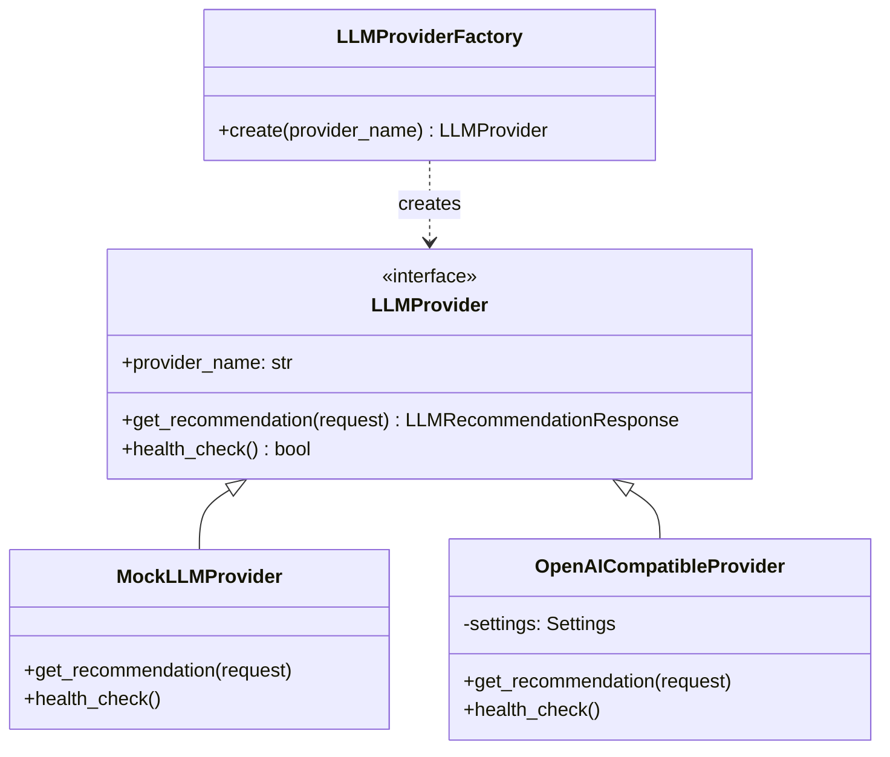
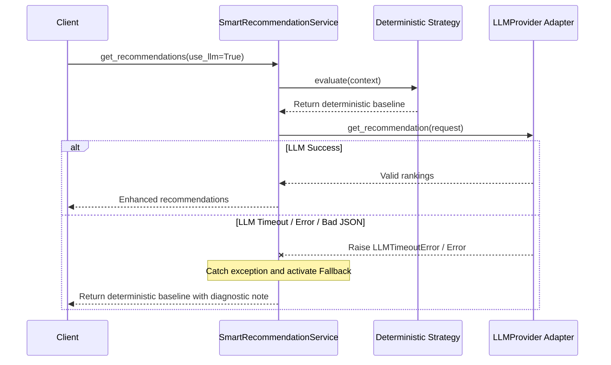

# LLM Integration Architecture & Privacy Guarantee

## 1. Adapter Pattern Architecture

The AI recommendation component implements the **Adapter Pattern** through the `LLMProvider` abstract base class. This shields domain services from specific cloud vendor SDKs.



---

## 2. Privacy & Data Minimization Guarantee

To protect employee privacy and enterprise data confidentiality, **zero PII is ever transmitted to external LLM providers**.

### What IS Transmitted:
- Anonymized technician UUID strings.
- Technical skill names and numeric proficiency levels ($1$–$5$).
- Years of professional experience.
- Current active incident counts and maximum capacity limits.
- Incident category, priority level, required skill, and technical description.

### What is NEVER Transmitted:
- Technician full names, employee IDs, email addresses, or phone numbers.
- Reporter identity or employee personal details.
- User passwords, credentials, or internal network IPs.

---

## 3. Strict Schema Validation

All provider responses must parse into the Pydantic v2 `LLMRecommendationResponse` schema:

```json
{
  "rankings": [
    {
      "technicianId": "550e8400-e29b-41d4-a716-446655440000",
      "rank": 1,
      "relevanceScore": 92.5,
      "explanation": "Candidate possesses required skill level with optimal capacity."
    }
  ],
  "reasoning": "High-level synthesis of pool fit.",
  "confidence": 0.88
}
```

Any output containing conversational text, markdown formatting, or invalid fields is caught by Pydantic validation and routed to the deterministic fallback pipeline.

---

## 4. Fault Tolerance & Deterministic Fallback

Under no circumstance will an LLM outage cause an incident assignment or recommendation request to fail with an HTTP 500 error.


