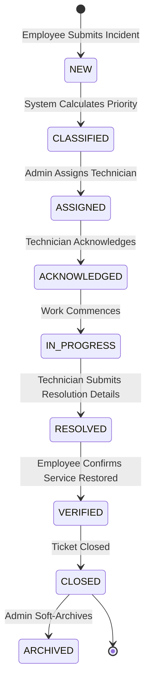

# I-ITSM — End-to-End User & Operations Guide

This guide explains how all three user roles (**Employee**, **Technician**, and **Administrator**) interact with the I-ITSM platform, covering authentication, incident reporting, duplicate detection, technician assignment, state machine lifecycle transitions, SLA governance, and administrative management.

---

## 1. Supported User Roles & Permissions

The I-ITSM authorization model enforces three discrete roles defined in `app/shared/enums.py`:

| Role | Target Portal | Core Permissions |
|---|---|---|
| **EMPLOYEE** | Employee Portal | Report new incidents; view real-time duplicate suggestions; track personal incidents; view lifecycle history, SLA countdowns, and comments; add user comments; view unread notifications and popup alerts. |
| **TECHNICIAN** | Technician Portal | View assigned incident queue; acknowledge assigned tickets; progress ticket status to `IN_PROGRESS` and `RESOLVED`; submit resolution notes; toggle real-time operational availability (`AVAILABLE` $\leftrightarrow$ `BUSY`). |
| **ADMIN** | Administrator Portal | Complete incident management (smart AI candidate recommendations, manual assignment, status updates); soft-archiving of closed tickets; duplicate incident merging; technician operational capacity and skills management; user management & role promotion; service catalogue curation; SLA policy governance & manual breach sweeps; immutable audit trail inspection. |

---

## 2. Authentication & Account Management

### 2.1 Employee Self-Registration
- Open the application at [http://localhost:5173](http://localhost:5173) and click **Sign up**.
- Fill in **Full Name**, **Username**, **Email Address**, and **Password** (minimum 8 characters).
- By design, all self-registered accounts are automatically assigned the `EMPLOYEE` role.

### 2.2 Administrator Bootstrap & Promotion
- **CLI Bootstrap (Initial Admin):**
  To create the very first system administrator on a clean machine:
  ```bash
  cd backend
  source .venv/bin/activate
  python create_admin.py --username superadmin --email admin@example.com --password "AdminPass@123" --full-name "Chief Admin"
  ```
- **In-App Admin Promotion:**
  Existing administrators can promote any user to Admin via the **User Management** tab by clicking **Promote to Admin**.

### 2.3 Promoting a User to Technician & Configuring Profile
In I-ITSM, **user accounts** and **technician profiles** are strictly separated:
- A *User Account* represents authentication identity (credentials, email, name, role).
- A *Technician Profile* represents operational capability (years of experience, max concurrent ticket capacity, availability status, and technical skills portfolio).

#### Step-by-Step Workflow:
1. **Role Promotion:**
   - Log in as an Administrator (`sysadmin`).
   - Navigate to **User Management**.
   - Locate the target user and click **Promote to Technician**. The user's role is updated to `TECHNICIAN` in the database.
2. **Profile Configuration:**
   - Navigate to the **Technicians** tab.
   - The promoted user immediately appears with status **Profile Not Configured**.
   - Click **Add Technician Profile** (or **Complete Profile**).
   - In the modal dialog:
     - Set **Experience (Years)** (e.g. `4`).
     - Set **Max Active Incidents** (e.g. `5`).
     - Set initial **Availability** (`AVAILABLE` or `BUSY`).
     - Select one or more domain skills (e.g., `NETWORK`, `SECURITY`, `CLOUD`) with proficiency ratings from $1$ to $5$.
   - Click **Save Profile**.
   - The user is now fully configured, active, and eligible for manual and algorithmic incident assignment.

---

## 3. Employee Workflows

### 3.1 Reporting an Incident
1. From the navigation header, select **Report Incident**.
2. Complete the reporting form:
   - **Service:** Select the affected enterprise IT service (e.g., *Production Database Cluster*, *Core Network Infrastructure*).
   - **Category:** Choose the domain category (`HARDWARE`, `SOFTWARE`, `NETWORK`, `DATABASE`, `CLOUD`, `SECURITY`, `AUTHENTICATION`, `APPLICATION`, `STORAGE`).
   - **Impact ($1$–$5$):** Number of personnel or departments impaired.
   - **Urgency ($1$–$5$):** Business time-sensitivity for restoration.
   - **Description:** Clear technical explanation of the failure.
3. **Real-Time Duplicate Warnings:**
   - As you type the description, the frontend asynchronously queries `/api/v1/incidents/search`.
   - If an open incident in the same category matches your description, a warning card appears displaying the matching incident code, status, and similarity score.
4. Click **Submit Incident**.
5. The system deterministically computes ticket priority ($P1$ to $P4$), assigns a unique tracking code (e.g., `INC-8F2A1B0C`), and redirects to the ticket view.

### 3.2 Tracking Incidents & Collaborating
1. Open **My Incidents** to view all tickets submitted by your account.
2. Filter tickets by priority ($P1$–$P4$) or lifecycle status.
3. Click any ticket to open the **Incident Details** view:
   - **Status Timeline:** Visual progress tracker showing `NEW` $\rightarrow$ `ASSIGNED` $\rightarrow$ `IN_PROGRESS` $\rightarrow$ `RESOLVED` $\rightarrow$ `CLOSED`.
   - **SLA Deadlines:** Live countdown timers showing response and resolution targets.
   - **Comments Thread:** Exchange messages, logs, and updates with the assigned technician.

---

## 4. Technician Workflows

### 4.1 Managing Operational Availability
- Technicians have an instant **Availability Toggle** in the top navigation bar.
- Switch between **Available** (eligible to receive new assignments) and **Busy** (temporarily paused from new allocations).

### 4.2 Working the Assigned Incident Queue
1. Navigate to **My Incidents** (filtered to tickets assigned to your user account).
2. Click on any assigned incident to open the **Incident Resolution** panel:
   - **Step 1 — Acknowledge:** Click **Acknowledge Ticket**. Lifecycle status advances to `ACKNOWLEDGED`.
   - **Step 2 — Begin Work:** Once diagnostic work begins, click **Start Work**. Lifecycle status advances to `IN_PROGRESS`.
   - **Step 3 — Collaborate:** Post progress updates or request reproduction details via the collaborative comment box.
   - **Step 4 — Resolve:** When service is restored, input comprehensive text into the **Resolution Details** field (e.g., *"Replaced faulty SFP+ transceiver in rack B2 and verified zero packet loss"*) and click **Submit Resolution**. Lifecycle status advances to `RESOLVED`, stopping the SLA resolution timer.

---

## 5. Administrator Workflows

### 5.1 Executive KPI Dashboard
Navigate to **Dashboard** for real-time operational metrics:
- Total Incidents, Active Tickets, SLA Breached count, and Overall SLA Compliance percentage.
- Active Technicians count and category breakdown charts.

### 5.2 Technician Assignment & Smart Recommendations
1. Open any unassigned incident in `NEW` or `CLASSIFIED` status.
2. In the **Assignment** panel, click **⚡ Get Smart Recommendations**.
3. Review the ranked candidate table:
   - Candidate name and operational availability.
   - Skill proficiency and matched domain tags.
   - Active workload vs. maximum capacity.
   - Explainable justification text generated by the ranking engine.
4. Click **Assign** next to the desired candidate.
5. Alternatively, select any eligible technician from the **Manual Assignment** dropdown and click **Assign Technician**.

### 5.3 Duplicate Incident Merging
1. In the Incident Details panel, if related tickets report the same root failure, click **View Duplicates**.
2. Review similarity tokens and confidence scores.
3. Click **Merge into this Incident**.
   - The secondary ticket is automatically closed.
   - The secondary ticket points its `merged_into_incident_id` reference to the primary ticket.
   - An audit trail record is generated documenting the merge event.

### 5.4 Incident Archiving
1. Open any incident in `CLOSED` status.
2. Click **Archive Incident**.
3. The incident transitions to read-only compliance storage (`is_archived = true`), preserving all comments, SLA metrics, and audit logs.
4. View archived records under the **Archived Incidents** tab.

### 5.5 SLA Policy Administration & Audit Logs
- **SLA Policies:** Configure response and resolution target hours for $P1$, $P2$, $P3$, and $P4$ priorities.
- **Manual SLA Sweep:** Click **Trigger SLA Check Sweep** to execute an immediate evaluation of active timers.
- **Audit Logs:** Navigate to **Audit Logs** to query append-only historical records across all system actions, filterable by actor or action type.

---

## 6. Incident Lifecycle State Machine


