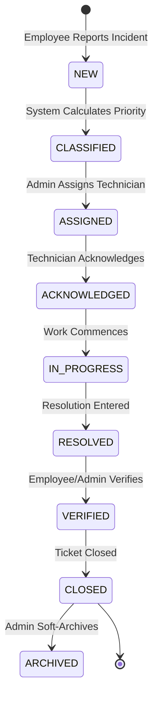
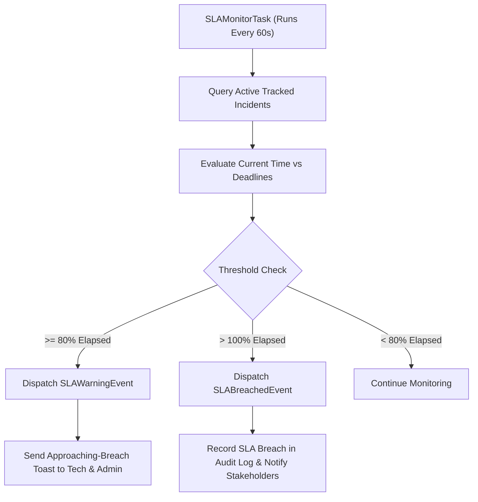

# End-to-End User Workflows

## 1. Incident Lifecycle Workflow

The core operational journey of an incident through the system:

### Stage Transitions:
1. **Reporting (`NEW`):**
   - Employee fills out the report form with category, service, impact ($1$–$5$), urgency ($1$–$5$), and description.
   - Real-time duplicate detection checks open tickets and displays warnings if similar issues exist.
   - On submission, `IncidentCreatedEvent` initiates SLA timers, creates an audit log entry, and delivers a confirmation notification.
2. **Classification (`CLASSIFIED`):**
   - The `PriorityCalculator` deterministically scores the ticket and assigns priority ($P1$, $P2$, $P3$, or $P4$).
3. **Smart Assignment (`ASSIGNED`):**
   - Admin requests smart recommendations (`SKILL_BASED` or `LEAST_LOADED` with optional LLM reasoning).
   - System filters candidates by availability, skill match, and active workload capacity.
   - Admin assigns technician. `IncidentAssignedEvent` notifies the technician, updates the audit log, and marks the SLA first-response metric.
4. **Acknowledgment (`ACKNOWLEDGED`):**
   - Assigned technician reviews the incident and acknowledges receipt.
5. **Investigation & Work (`IN_PROGRESS`):**
   - Technician updates status to `IN_PROGRESS` while working on resolution.
   - Both employee and technician can exchange comments in the collaborative thread.
6. **Resolution (`RESOLVED`):**
   - Technician enters detailed `resolutionDetails` and sets status to `RESOLVED`.
   - The SLA resolution timer stops.
7. **Verification & Closure (`VERIFIED` $\rightarrow$ `CLOSED`):**
   - Employee verifies that the service is restored, transitioning to `VERIFIED`.
   - Admin or system closes the incident (`CLOSED`).
8. **Archiving (`ARCHIVED`):**
   - Closed incidents can be soft-archived by an Admin. The incident is placed in read-only mode and preserved for audit compliance.

---

## 2. Duplicate Detection & Merging Workflow

1. An employee or admin notices similar tickets reporting the same system outage.
2. The Admin opens `GET /incidents/{id}/duplicates` to inspect similarity scores and matched tokens.
3. The Admin executes `POST /incidents/{primary_id}/merge` with the secondary incident ID.
4. The system:
   - Sets the secondary incident status to `CLOSED`.
   - Links `merged_into_incident_id` on the secondary ticket to the primary ticket.
   - Records audit log entries on both tickets documenting the merge.
   - Dispatches a notification to the secondary ticket reporter pointing them to the primary ticket.

---

## 3. Automated SLA Breach & Warning Workflow

